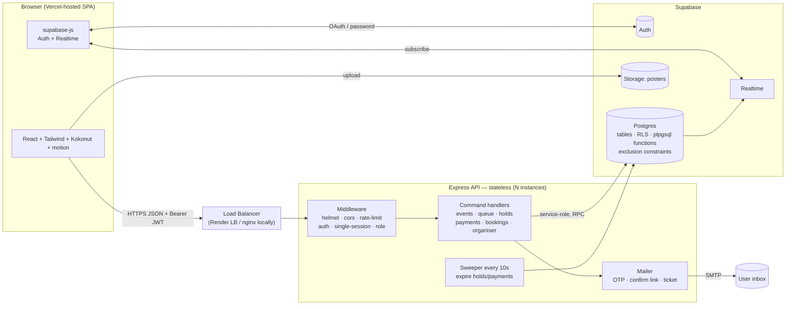
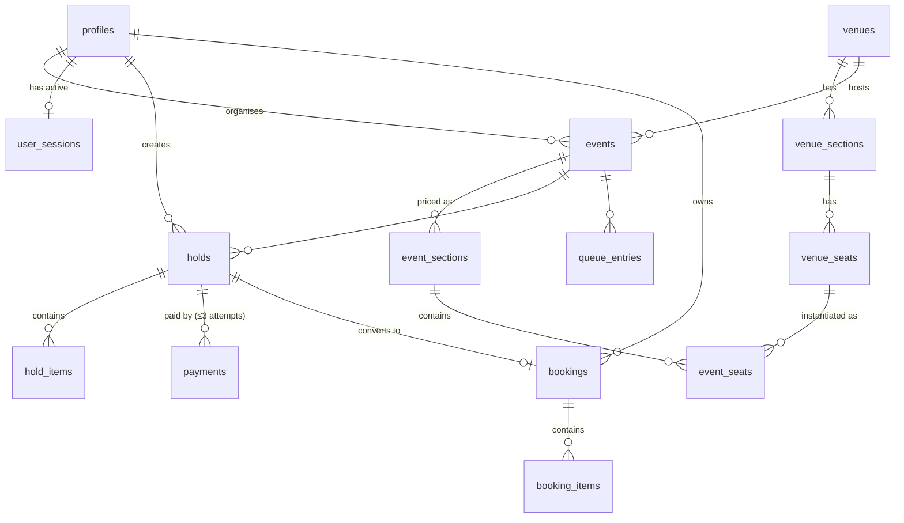
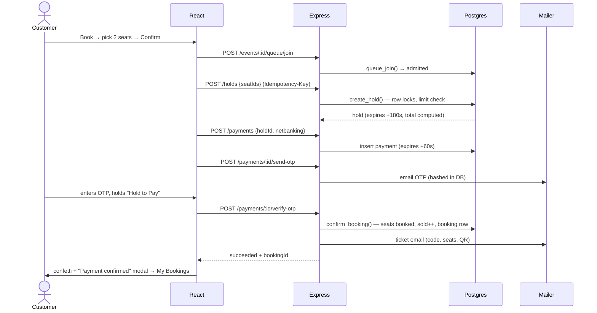

# Encore — Event Booking Platform
### Product Requirements & Project Review Document (PRD)

| | |
|---|---|
| **Version** | 1.0 |
| **Date** | 28 Oct 2026 |
| **Team** | 4 developers (P1–P4), each running one AI coding agent on their own system |
| **Timebox** | 2 hours build + testing afterwards |
| **Companion doc** | [WORK_DISTRIBUTION.md](WORK_DISTRIBUTION.md): who builds what, timeline, merge rules |

> "Encore" is a working name. To rename it, change `APP_NAME` in `client/src/lib/config.ts`. No other file should hard-code the name.

---

## Table of Contents

0. [Evaluation Criteria → Where This PRD Answers It](#0-evaluation-criteria--where-this-prd-answers-it)
1. [Product Overview, Users & Scope](#1-product-overview-users--scope)
2. [Booking Rules & Edge Cases](#2-booking-rules--edge-cases)
3. [Tech Stack](#3-tech-stack)
4. [Architecture](#4-architecture)
5. [Data Model (Supabase / PostgreSQL)](#5-data-model-supabase--postgresql)
6. [Concurrency: How Two Users Never Get the Same Seat](#6-concurrency-how-two-users-never-get-the-same-seat)
7. [Backend Plan (API Contract)](#7-backend-plan-api-contract)
8. [Frontend Plan (Design System + Every Page)](#8-frontend-plan-design-system--every-page)
9. [Payments (Mock): Holds, Timers, Retries, Failures](#9-payments-mock-holds-timers-retries-failures)
10. [Security: Can a User Cheat?](#10-security-can-a-user-cheat)
11. [Organiser Dashboard: Correct Numbers](#11-organiser-dashboard-correct-numbers)
12. [Methodology](#12-methodology)
13. [Agent Instructions](#13-agent-instructions)
14. [Tests & End-to-End Workflows](#14-tests--end-to-end-workflows)
15. [Deployment & Runbook](#15-deployment--runbook)
16. [Glossary](#16-glossary)

---

## 0. Evaluation Criteria → Where This PRD Answers It

| # | Evaluation question | Answered in | Proof at demo time |
|---|---|---|---|
| 1 | Who are your users, what can they do, what's out of scope? | §1 | Role matrix and out-of-scope list |
| 2 | Booking rules incl. edge cases | §2 | Rules R1–R24; tests T-xx linked to each |
| 3 | Architecture and why each part | §4 | Diagram plus a "why" for each part |
| 4 | Data model fits variant? Why SQL? | §5, §5.4 | ERD, constraints, SQL vs Mongo table |
| 5 | Two users never get the same seat | §6 | Row-lock SQL, unique index, 50-parallel-request test (T-05) |
| 6 | Full booking flow end to end | §8, §9, §14.3 | Playwright E2E-01 run, live demo |
| 7 | Holds, retries, failed payments | §9 | State machines; tests T-08…T-14 |
| 8 | Can a user cheat / reach others' data? | §10 | Threat table; tests T-15…T-22 |
| 9 | Organiser dashboard numbers correct | §11 | Single SQL view and reconciliation test T-23 |
| 10 | Deployed, runnable, testable, understandable | §15, README | Vercel and Render URLs, seed users, `npm test` |

---

## 1. Product Overview, Users & Scope

### 1.1 One-liner
A web app where **organisers** host events at real-style venues (stadiums with individual seats, grounds with priced sections, or open halls) and **customers** browse events, pick seats or sections, hold them for 3 minutes, pay through a realistic mock payment flow, and receive tickets.

### 1.2 Users

| Role | Who | Signs in with |
|---|---|---|
| **Customer** | Person buying tickets | Google (Supabase OAuth) **or** username and password |
| **Organiser** | Person or company hosting events | Google (Supabase OAuth) **or** username and password |
| *(system)* | Sweeper and queue admitter running on the server | n/a |

Each account has exactly **one role**, chosen at sign-up and stored in `profiles.role`. To demo both roles, use two accounts.

### 1.3 What each user can do

| Capability | Customer | Organiser |
|---|:-:|:-:|
| Sign up / log in (Google or username+password) | ✅ | ✅ |
| Have only one active session (switch-device prompt) | ✅ | ✅ |
| Browse published events (coverflow gallery) | ✅ | ✅ (read only) |
| Join virtual waiting room for a hot event | ✅ | ❌ |
| Select seats (seated) / quantity per section (sectioned) / quantity (free) | ✅ | ❌ |
| Hold seats for 3 min | ✅ | ❌ |
| Pay (mock UPI-QR / mock Net-banking with email OTP / email confirm link) | ✅ | ❌ |
| See *My Bookings* + receive ticket email | ✅ | ❌ |
| Browse venues (capacity, layout, instructions) | ❌ | ✅ |
| Host an event (venue, time, seating mode, prices, poster) | ❌ | ✅ |
| See own events dashboard (sold, held, available, revenue, payments) | ❌ | ✅ (own events only) |

### 1.4 Out of scope (explicitly **not** built)
- Real payment gateways, refunds, cancellations, partial refunds, chargebacks.
- Ticket transfer, resale, coupons/discounts (the "₹300 OFF" style banner is decorative only).
- Multiple shows per event (1 event = 1 time slot at 1 venue).
- Venue creation by organisers (venues are **seeded**; organisers choose from them).
- Admin role, moderation, reviews, ratings, recommendations.
- Native mobile apps (the web app is responsive and mobile-first).
- Multi-language, multi-currency (INR only, stored in **paise**).
- Stopping one human from using many accounts (we limit per account only).
- Event editing after publish (organisers can only create; editing is a stretch goal).

### 1.5 Interpretation of "no CRUD or API apps"
- No generic CRUD scaffolds (no "table editor"-style admin pages, no auto-generated REST over tables, no Supabase client-side `insert/update/delete` from the browser).
- The backend exposes **intent-based commands** such as `POST /holds`, `POST /payments/:id/verify-otp` and `POST /organiser/events/check-availability`. Each command enforces business rules inside one DB transaction.
- No low-code API builders or mock-API SaaS. The frontend's mocks are local fixtures only, used until the real server is ready.

---

## 2. Booking Rules & Edge Cases

All timings are **server-authoritative** and configurable via env for testing:

| Env var | Default | Meaning |
|---|---|---|
| `HOLD_SECONDS` | 180 | Seat/section hold lifetime |
| `PAYMENT_SECONDS` | 60 | Window for a single payment attempt |
| `MAX_TICKETS_PER_USER` | 10 | Per user, per event (held + booked) |
| `MAX_PAYMENT_ATTEMPTS` | 3 | Attempts per hold |
| `MAX_OTP_ATTEMPTS` | 3 | Wrong OTPs per payment before it fails |
| `QUEUE_MAX_ACTIVE` | 50 | Concurrent "admitted" shoppers per event |
| `QUEUE_ADMISSION_SECONDS` | 300 | How long an admission is valid |
| `VENUE_TURNOVER_MINUTES` | 60 | Gap required between events at the same venue |

### 2.1 Rules

| ID | Rule | Enforced where | Test |
|---|---|---|---|
| **R1** | A seat can be in exactly one state: `available`, `held`, `booked`. | DB check constraint | T-05 |
| **R2** | First come, first served: the first transaction to lock a seat wins. Others get `SEAT_TAKEN` immediately. | `create_hold()` row locks | T-05, T-06 |
| **R3** | A hold lasts `HOLD_SECONDS` (3 min) from creation. Holds are never extended. | `holds.expires_at` | T-08 |
| **R4** | An expired hold is treated as released **even before the sweeper runs** (lazy expiry: `held_until < now()` counts as available). | `create_hold()` WHERE clause | T-09 |
| **R5** | A user has at most **one active hold per event**. A new hold for the same event releases the previous one first. | `create_hold()` | T-10 |
| **R6** | A user can hold + own at most `MAX_TICKETS_PER_USER` (10) tickets per event across all bookings and tabs. Checked under a per-(user,event) advisory lock, so two tabs cannot both pass. | `create_hold()` | T-11 |
| **R7** | A single hold must contain 1–10 tickets. | API (zod) + DB | T-11 |
| **R8** | Seated events: seats are picked individually. Sectioned events: quantity per section. Free events: quantity only. | Event `seating_mode` | T-03 |
| **R9** | Section availability = `capacity − sold − active_held_qty`. A section hold fails with `SOLD_OUT` if the request exceeds it. | `create_hold()` with section row lock | T-07 |
| **R10** | Prices come **only** from `event_sections.price_paise`. Any price the client sends is ignored. | Server + DB | T-16 |
| **R11** | Seat IDs must belong to the requested event. Otherwise the request fails with `INVALID_SEATS`. | `create_hold()` | T-17 |
| **R12** | A payment can start only if the hold is active and has ≥ `PAYMENT_SECONDS` remaining. Otherwise `HOLD_TOO_SHORT` and the customer re-selects. | `POST /payments` | T-12 |
| **R13** | Each payment attempt expires after `PAYMENT_SECONDS` (60 s). After that it is `expired`, the hold stays active, and the customer may retry. | DB + sweeper | T-13 |
| **R14** | A hold allows at most `MAX_PAYMENT_ATTEMPTS` (3) attempts. Only one attempt can be `pending` at a time; creating a new one expires the old one. | Partial unique index | T-14 |
| **R15** | OTP: 6 digits, stored hashed, valid for the payment window, max 3 wrong tries. The 3rd wrong try fails the payment. | Server | T-14 |
| **R16** | Confirmation is idempotent. Confirming an already-succeeded payment returns the same booking, and double-clicking or double links never create two bookings. | `confirm_booking()` | T-18 |
| **R17** | A payment can only be confirmed if its hold is still active **at confirm time**. Otherwise the payment fails with `HOLD_EXPIRED`. Since payments are mock, no money is taken. | `confirm_booking()` | T-12 |
| **R18** | Tickets are confirmed **only** after the server marks the payment `succeeded`. The browser never decides success. | Server | T-19 |
| **R19** | Bookings close at `starts_at`. Holds and payments for a started event are rejected with `EVENT_NOT_BOOKABLE`. | `create_hold()` | T-04 |
| **R20** | One active session per account. Logging in on a new device shows *"You're signed in elsewhere. Switch to this device?"* Choosing **Switch** revokes the old session immediately (API returns `SESSION_REVOKED`). Choosing **Cancel** signs out the new one. | `user_sessions` + middleware | T-20 |
| **R21** | Virtual waiting room: when an event has ≥ `QUEUE_MAX_ACTIVE` admitted shoppers, new shoppers queue FIFO. Holds require a valid admission. | `queue_*` functions | T-21 |
| **R22** | A venue cannot host two events whose time ranges (plus 60 min turnover) overlap. | Postgres **exclusion constraint** | T-24 |
| **R23** | The same event (same organiser + same normalised title) cannot run at overlapping times at different venues. | Exclusion constraint | T-25 |
| **R24** | Event capacity ≤ venue capacity. For sectioned venues, each section capacity ≤ the venue section's capacity. Free seating on a seated venue uses one "General Admission" section. | `create_event()` | T-26 |

### 2.2 Edge cases handled (scenario list)

| Scenario | Behaviour |
|---|---|
| Two users click the same seat at the same millisecond | One gets the hold. The other gets `409 SEAT_TAKEN`, a toast appears, and the seat turns grey via realtime. |
| User picks 4 seats and 1 was just taken | The **whole** hold fails (atomic) and the UI asks them to re-pick that one seat. |
| User opens 3 tabs and tries 4+4+4 | The advisory lock serialises the requests, the 3rd fails with `LIMIT_EXCEEDED` (and R5 releases older holds anyway). |
| Hold expires while the customer is on the payment page | The countdown hits 0 and a modal says *"Your seats were released."* The server rejects any confirm. |
| Payment timer expires (60 s) but the hold still has time | The attempt shows "Payment failed: timed out" with a **Retry** button (new attempt, same hold). |
| QR link clicked twice, or both QR and OTP used | The first confirm wins and the second returns the same booking (idempotent). |
| Email confirm link opened after expiry | The page shows "This payment link has expired". |
| Customer closes the tab mid-payment | The hold expires after 3 min and the sweeper or lazy expiry frees the seats. |
| Server instance crashes mid-request | The DB transaction rolls back, so there are never half-held seats. |
| User logs in on a phone while booking on a laptop | The laptop's next API call gets `SESSION_REVOKED` and a realtime event shows a "Signed out elsewhere" modal. The hold remains until expiry. |
| Organiser picks an overlapping slot | Live availability check shows a red "Venue busy 7–10 PM (Event X)" warning. Submit is blocked, and the server double-checks via constraint. |
| Organiser uploads no poster | A generated poster (gradient + title + venue + date/time) is rendered. |
| Event has started | Book button disabled ("Bookings closed"); API rejects. |
| User has 10 tickets already | Seat map shows "You've reached the 10-ticket limit for this event". |

---

## 3. Tech Stack

| Layer | Choice | Why |
|---|---|---|
| Frontend | **React 18 + Vite + TypeScript** | Fast dev server; TS matches Kokonut/shadcn components and catches contract mistakes between 4 parallel devs |
| Styling | **Tailwind CSS v4** + CSS variables | Required by Kokonut UI; design tokens in one file |
| UI templates | **Kokonut UI** (shadcn-style copy-in components), **motion.dev** (`motion` package) | Polished components plus physics-based animation (coverflow, confetti, transitions) |
| Icons | `lucide-react` | Consistent line icons |
| Routing | `react-router-dom` v6 | Standard SPA routing |
| Client utils | `@supabase/supabase-js`, `qrcode.react`, `sonner` (toasts), `date-fns`, `clsx`, `tailwind-merge` | n/a |
| Backend | **Node 20 + Express 4** (JavaScript ESM) | Simple and familiar; holds the business logic |
| Validation | `zod` | Same schemas validate every request body |
| Security middleware | `helmet`, `cors`, `express-rate-limit` | Headers, CORS allowlist, request rate limits |
| Email | `nodemailer` (Gmail SMTP app-password) with `EMAIL_MODE=console` fallback | Supabase Auth email only sends auth emails. For OTP and ticket emails we need our own sender |
| Logging | `pino` | Structured logs with `instance_id` (shows load balancing) |
| Database | **Supabase Postgres** | Transactions, row locks, exclusion constraints, RLS, Realtime, Storage, Auth in one place |
| Auth | **Supabase Auth** (Google OAuth + email/password, username mapped server-side) | Managed, secure; JWT has a `session_id` claim we use for single-session |
| Realtime | Supabase Realtime (`postgres_changes` on `event_seats`, `payments`, `user_sessions`) | Live seat greying, payment-confirmed push, forced logout |
| File storage | Supabase Storage bucket `posters` | Poster uploads |
| Load balancer | Render built-in LB (≥2 instances) in prod; **nginx** round-robin over 2 containers locally (`infra/`) | Shows horizontal scaling. The server is stateless, so any instance can serve any request |
| Hosting | **Vercel** (client), **Render** (server), **Supabase Cloud** (DB) | Free tiers, Git-based deploys |
| Testing | `vitest` + `supertest` (server), `vitest` (client utils), **Playwright** (E2E), Node script for concurrency | n/a |

---

## 4. Architecture

### 4.1 Diagram



### 4.2 Why each part

| Part | Why it exists | Why not something else |
|---|---|---|
| **React SPA on Vercel** | All UI. Vercel's CDN gives instant global load and preview deploys per branch | Next.js SSR isn't needed. Every page is behind auth or is client-interactive |
| **Supabase Auth in browser** | Google OAuth and secure password handling without building it | Rolling our own auth is risky and slow |
| **Express API** | **All writes** go through here so business rules (limits, prices, timers, OTP) can't be bypassed by the browser | Browser writing straight to Supabase tables would let a user edit prices or statuses |
| **Stateless API + Load balancer** | Several instances share load. No in-memory state means any instance can handle any request (queue, holds and sessions all live in Postgres) | Sticky sessions or in-memory queues break when you scale or an instance restarts |
| **Postgres functions (`create_hold`, `confirm_booking`, …)** | Atomic multi-row changes in **one transaction** close to the data. This is the core of seat-safety | Doing it in Node with several round trips opens race windows |
| **Exclusion constraints** | The DB itself refuses overlapping venue/event slots, even if two organisers submit at once | App-level "check then insert" has a race |
| **Row Level Security** | Defence in depth: even with the anon key, a user can only *read* public events or their own bookings and can never write | n/a |
| **Realtime** | Seats grey out live and the payment page learns instantly that the QR was approved on a phone, without heavy polling | Polling every second at scale is wasteful (polling every 3 s is the fallback) |
| **Sweeper** | Frees expired holds so seat maps look accurate | Correctness doesn't depend on it, because lazy expiry handles it (R4) |
| **Mailer** | OTP, confirm-link and ticket emails | Supabase can't send arbitrary transactional emails without an extra provider |

### 4.3 Repository layout (monorepo)

```
/
├─ client/                     React app (Vercel root)
│  ├─ src/
│  │  ├─ main.tsx, App.tsx     router (P4)
│  │  ├─ lib/                  supabase, api client, auth context, config (P4)
│  │  ├─ ui/                   design-system + kokonut components (P4)
│  │  ├─ layouts/              AppShell, Header, ProfileMenu (P4)
│  │  ├─ pages/auth/           Login, Signup, RoleOnboarding, SessionConflict (P4)
│  │  ├─ pages/organiser/      Venues, VenueDetail, HostEvent, MyEvents, EventDashboard (P4)
│  │  ├─ features/organiser/   forms, availability checker, stats widgets (P4)
│  │  ├─ pages/customer/       Events, EventDetail, Booking, Payment, MockPay, MyBookings, WaitingRoom (P3)
│  │  ├─ features/booking/     SeatMap, SectionPicker, HoldTimer, Coverflow, Confetti, api (P3)
│  │  └─ mocks/                customer/ (P3), organiser/ (P4)
│  └─ vercel.json
├─ server/                     Express API (Render) (P2)
│  ├─ src/{app.js,index.js,config.js}
│  ├─ src/middleware/          auth, session, role, rateLimit, error
│  ├─ src/routes/              auth, events, queue, holds, payments, bookings, organiser, health
│  ├─ src/services/            mailer, otp, sweeper, supabaseAdmin
│  └─ test/
├─ supabase/                   (P1)
│  ├─ migrations/              0001_schema.sql … 0006_rls.sql
│  └─ seed/                    venues.sql, generate-seats.js, demo-users.js, events.sql
├─ infra/                      nginx.conf, docker-compose.yml (P2)
├─ tests/                      db/ concurrency scripts, e2e/ Playwright (P1)
├─ render.yaml                 (P2)
├─ PRD.md, WORK_DISTRIBUTION.md, README.md
└─ .gitignore, .env.example files
```

---

## 5. Data Model (Supabase / PostgreSQL)

> Money = integer **paise** (`₹1999` → `199900`). Times = `timestamptz` in UTC; the UI shows them in IST.

### 5.1 ERD



### 5.2 Tables

| Table | Key columns | Notes |
|---|---|---|
| `profiles` | `id uuid PK → auth.users`, `role text check ('customer','organiser')`, `username citext unique`, `full_name`, `email`, `created_at` | Created by trigger on `auth.users` insert (role from `raw_user_meta_data`). Google sign-ups without a role go to onboarding |
| `user_sessions` | `user_id PK`, `session_id uuid`, `device_label text`, `updated_at` | Exactly one active session per user (R20) |
| `venues` | `id`, `name`, `city`, `address`, `venue_type check ('seated','sectioned','open')`, `capacity int`, `image_url`, `layout jsonb`, `instructions text` | Seeded |
| `venue_sections` | `id`, `venue_id`, `code`, `name`, `kind check ('seated','standing')`, `capacity`, `color`, `sort_order`, `geometry jsonb` | e.g. "Gold Standing", "Block A" |
| `venue_seats` | `id`, `section_id`, `row_label`, `seat_number`, `label`, `x real`, `y real` | Only for `seated` sections. `unique(section_id,row_label,seat_number)` |
| `events` | `id`, `organiser_id`, `venue_id`, `title`, `title_key text generated (lower(btrim(title)))`, `event_type`, `description`, `poster_url null`, `poster_description`, `seating_mode check ('assigned','sectioned','free')`, `capacity`, `starts_at`, `ends_at`, `busy_from`, `busy_until`, `status check ('published','cancelled')`, `max_per_user default 10`, `created_at` | `check (ends_at > starts_at)`. `busy_*` = times ± turnover (set in `create_event`) |
| `event_sections` | `id`, `event_id`, `venue_section_id null`, `name`, `color`, `price_paise int check (>0)`, `capacity int`, `sold int default 0 check (sold <= capacity)` | Per-event pricing. Free mode = one row "General Admission" |
| `event_seats` | `id`, `event_id`, `event_section_id`, `venue_seat_id`, `label`, `status check ('available','held','booked')`, `hold_id null`, `held_until null`, `booking_id null` | `unique(event_id, venue_seat_id)`. Only when `seating_mode='assigned'` |
| `holds` | `id`, `user_id`, `event_id`, `status check ('active','converted','expired','released')`, `expires_at`, `total_paise`, `ticket_count`, `idempotency_key`, `created_at` | `unique(user_id, idempotency_key)`. Partial unique index on `(user_id, event_id) where status='active'` (R5) |
| `hold_items` | `id`, `hold_id`, `event_section_id`, `event_seat_id null`, `qty int`, `unit_price_paise` | Seat rows have qty=1 |
| `payments` | `id`, `hold_id`, `user_id`, `attempt_no`, `method check ('upi_qr','netbanking')`, `amount_paise`, `status check ('pending','succeeded','failed','expired')`, `failure_reason`, `otp_hash`, `otp_attempts`, `confirm_token_hash`, `expires_at`, `created_at`, `confirmed_at` | Partial unique `(hold_id) where status='pending'` and `(hold_id) where status='succeeded'` |
| `bookings` | `id`, `user_id`, `event_id`, `hold_id unique`, `payment_id unique`, `ticket_code text unique`, `total_paise`, `ticket_count`, `status 'confirmed'`, `created_at` | `ticket_code` e.g. `ENC-7F3K9Q` |
| `booking_items` | `id`, `booking_id`, `event_section_id`, `event_seat_id null`, `qty`, `unit_price_paise` | **Partial unique `(event_seat_id) where event_seat_id is not null`**: a final guard against double booking |
| `queue_entries` | `id bigserial`, `event_id`, `user_id`, `status check ('waiting','admitted','done','expired')`, `admitted_at`, `expires_at`, `created_at` | Partial unique `(event_id,user_id) where status in ('waiting','admitted')` |

**Constraints for R22/R23** (requires `create extension btree_gist`):

```sql
alter table events add constraint venue_no_overlap
  exclude using gist (venue_id with =, tstzrange(busy_from, busy_until) with &&)
  where (status <> 'cancelled');

alter table events add constraint same_event_no_parallel_venues
  exclude using gist (organiser_id with =, title_key with =, tstzrange(starts_at, ends_at) with &&)
  where (status <> 'cancelled');
```
The server maps error `23P01` + constraint name to `VENUE_CLASH` / `EVENT_CLASH`.

### 5.3 Venue layout JSON (`venues.layout`)

One format drives both seed generation and the SVG seat map:

```json
{
  "viewBox": "0 0 1000 800",
  "stage": { "shape": "rect", "x": 350, "y": 20, "w": 300, "h": 60, "label": "STAGE" },
  "sections": [
    { "code": "A", "name": "Block A", "kind": "seated", "color": "#F4A28C",
      "shape": "arc", "cx": 500, "cy": 120, "innerR": 260, "outerR": 380,
      "startDeg": 200, "endDeg": 228, "rows": 6, "seatsPerRow": 14 },
    { "code": "GOLD", "name": "Gold Standing", "kind": "standing", "color": "#FFC24B",
      "shape": "rect", "x": 330, "y": 420, "w": 340, "h": 90, "capacity": 600 }
  ]
}
```
`supabase/seed/generate-seats.js` computes each seat's `(x,y)` from `arc`/`grid` shapes and inserts `venue_seats`.

**Seeded venues** (original names, layouts inspired by the reference images):

| Venue | City | Type | Layout |
|---|---|---|---|
| Sabarmati Bowl | Ahmedabad | `seated` | Horseshoe stadium: Pavilion L/R (front) + Blocks A–H in arcs + South Premium; **individual seats** (~840) |
| Lakeside Grounds | Bengaluru | `sectioned` | Stage + Solitaire L/R, Platinum L/R, Gold Standing, Silver Standing, Lounge; **choose section + qty** |
| Courtyard Theatre | Mumbai | `seated` | Simple 12 rows × 20 seats grid, 3 price bands (240 seats) |
| The Loft | Bengaluru | `open` | No layout, **capacity 150, quantity only** |

### 5.4 Does the model fit our variant? Why SQL, not MongoDB?

Our variant mixes **three seating modes** (individual seats, priced sections, free capacity) under hard correctness guarantees. Each guarantee maps directly to a relational feature:

| Need | PostgreSQL gives us | MongoDB equivalent |
|---|---|---|
| Never sell a seat twice | Row locks (`FOR UPDATE SKIP LOCKED`) + partial **unique index** on `booking_items.event_seat_id` | Possible with unique index, but multi-doc hold (N seats) needs a transaction plus manual retry handling |
| Hold N seats all-or-nothing | One transaction around several `UPDATE`s | Multi-document transactions (heavier, replica-set only) |
| No overlapping venue bookings | **Exclusion constraint** over time ranges, enforced by DB | No equivalent, so it becomes an app-level race |
| Section capacity counters | `CHECK (sold <= capacity)` | Validators exist but no cross-doc consistency |
| Dashboard aggregates | `SUM/COUNT/GROUP BY` in one view, always consistent | Aggregation pipelines over denormalised data |
| Ownership security | Row Level Security policies | App-only |
| Natural relations | venue → sections → seats → event_seats → holds → bookings | Lots of references, so joins happen in app code |

The data is highly relational and correctness matters more than schema flexibility, so **SQL**. The one flexible part (venue geometry) is stored as `jsonb`, which gives us document-style flexibility exactly where we need it.

---

## 6. Concurrency: How Two Users Never Get the Same Seat

Four layers of defence. Any single one would be enough for the common case; together they also cover the edge cases.

1. **Atomic conditional UPDATE with row locks** (primary guarantee). Inside `create_hold()`:
   ```sql
   with target as (
     select id from event_seats
     where event_id = p_event
       and id = any(p_seat_ids)
       and (status = 'available' or (status = 'held' and held_until < now()))
     order by id                       -- consistent lock order: no deadlocks
     for update skip locked            -- someone else mid-transaction? skip, don't wait
   )
   update event_seats s
      set status = 'held', hold_id = v_hold_id, held_until = v_expires
     from target t where s.id = t.id;
   get diagnostics v_got = row_count;
   if v_got <> cardinality(p_seat_ids) then
     raise exception 'SEAT_TAKEN';     -- whole transaction (incl. hold row) rolls back
   end if;
   ```
   Two concurrent requests for seat 42: the first locks the row. The second's `SKIP LOCKED` skips it, so its row count is short and it fails. If the first already committed, the second sees `status='held'`, matches 0 rows and fails. **Exactly one wins.**

2. **Section/free capacity** uses `SELECT … FROM event_sections WHERE id = $1 FOR UPDATE` (sections locked in id order), then checks `capacity − sold − active_held ≥ qty` while holding the lock. Concurrent buyers of "Gold Standing" are serialised for microseconds.

3. **Per-user advisory lock** `pg_advisory_xact_lock(hashtextextended(user_id||event_id,0))` serialises one user's parallel tabs, so the 10-ticket check (R6) can't be raced.

4. **Final DB guard**: partial unique index on `booking_items(event_seat_id)`. Even if a bug slipped through layers 1–3, Postgres would reject the second booking insert.

**Confirm path** (`confirm_booking(payment_id)`): locks the payment row `FOR UPDATE`, which makes it idempotent and race-free between QR and OTP. It then checks that the hold is active and unexpired, flips the hold's seats `held → booked` **only where `hold_id = this hold`**, increments `event_sections.sold`, inserts the booking and items, and marks the hold `converted`, all in one transaction.

**Proof (test T-05):** `tests/db/race.js` fires 50 parallel `POST /holds` for the same seat from 50 users. Expected: exactly **1 × 201** and **49 × 409 SEAT_TAKEN**. Afterwards `select count(*) from event_seats where status<>'available'` = 1.

---

## 7. Backend Plan (API Contract)

**Base URL:** `${VITE_API_URL}/api`. All bodies are JSON. Auth header: `Authorization: Bearer <supabase access_token>`.

### 7.1 Middleware chain (order matters)
`helmet` → `cors(allowlist: CLIENT_URL)` → `json(limit 50kb)` → `requestId + pino` → `globalRateLimit (300 req/min/IP)` → *route* → `requireAuth` (verify JWT with `supabase.auth.getUser`, cached 30 s) → `requireActiveSession` (JWT `session_id` == `user_sessions.session_id`, else `401 SESSION_REVOKED`) → `requireRole('customer'|'organiser')` → `zod validate` → handler → `errorHandler`.

Every response has the header `X-Instance-Id` (shows the LB in action).

### 7.2 Error format (shared by all)
```json
{ "error": { "code": "SEAT_TAKEN", "message": "One or more seats were just taken.", "details": { "seatIds": ["..."] } } }
```

| Code | HTTP | Meaning |
|---|---|---|
| `VALIDATION_ERROR` | 400 | zod failed |
| `UNAUTHENTICATED` | 401 | missing/invalid JWT |
| `SESSION_REVOKED` | 401 | signed in on another device |
| `EXISTING_SESSION` | 409 | claim without `force` while another session is active |
| `FORBIDDEN` | 403 | wrong role |
| `NOT_FOUND` | 404 | also used for "exists but not yours" (no data leak) |
| `SEAT_TAKEN` / `SOLD_OUT` | 409 | n/a |
| `LIMIT_EXCEEDED` | 409 | > 10 tickets |
| `INVALID_SEATS` | 400 | seats not in event |
| `EVENT_NOT_BOOKABLE` | 409 | started/cancelled |
| `NOT_ADMITTED` | 403 | waiting room not passed |
| `HOLD_EXPIRED` / `HOLD_TOO_SHORT` | 409 | n/a |
| `PAYMENT_EXPIRED` / `PAYMENT_NOT_PENDING` | 409 | n/a |
| `OTP_INVALID` | 400 | `details.attemptsLeft` |
| `MAX_ATTEMPTS` | 409 | payment attempts or OTP exhausted |
| `VENUE_CLASH` / `EVENT_CLASH` | 409 | `details.conflict` = {title, starts_at, ends_at} |
| `CAPACITY_INVALID` | 400 | n/a |
| `RATE_LIMITED` | 429 | n/a |

### 7.3 Endpoints

**Auth & session**

| Method & path | Body → Response | Notes |
|---|---|---|
| `POST /auth/signup` | `{username, email, password, fullName, role}` → `201 {ok}` | Server `auth.admin.createUser({email_confirm:true, user_metadata:{role,username,fullName}})`. Username unique check |
| `POST /auth/username-login` | `{username, password}` → `{access_token, refresh_token}` | Server resolves username → email, signs in, returns tokens; client calls `supabase.auth.setSession` |
| `POST /auth/role` | `{role}` → `{profile}` | One-time role pick for Google sign-ups (only if role is null) |
| `POST /session/claim` | `{force:boolean, deviceLabel}` → `200 {claimed:true}` or `409 EXISTING_SESSION {device, since}` | Call right after every login |
| `GET /me` | → `{id, role, username, fullName, email}` | n/a |

**Customer**

| Method & path | Body → Response |
|---|---|
| `GET /events?city=&type=` | → `[{id,title,eventType,posterUrl,posterDescription,venue:{name,city},startsAt,endsAt,seatingMode,minPricePaise,availability:'available'|'fast'|'sold_out'}]` |
| `GET /events/:id` | → `{...event, venue:{...,layout,imageUrl,instructions}, sections:[{id,name,color,pricePaise,capacity,available}], myTicketCount}` |
| `GET /events/:id/seats` | → `[{id,label,sectionId,x,y,status}]` (status `held` if active hold; never exposes who) |
| `POST /events/:id/queue/join` | → `{entryId,status:'admitted'|'waiting',position,admissionExpiresAt}` |
| `GET /queue/:entryId` | → same shape (client polls every 3 s while waiting) |
| `POST /holds` (header `Idempotency-Key`) | `{eventId, seatIds?:[], sections?:[{sectionId,qty}]}` → `201 {holdId,expiresAt,items:[{label|sectionName,qty,unitPricePaise}],totalPaise,ticketCount}` |
| `GET /holds/:id` | → hold with items and `secondsLeft` |
| `POST /holds/:id/release` | → `{released:true}` |
| `POST /payments` | `{holdId, method:'upi_qr'|'netbanking'}` → `201 {paymentId,amountPaise,expiresAt,attemptNo,qrUrl?}`. For `upi_qr` the server also emails a confirm link |
| `POST /payments/:id/send-otp` | → `{sent:true, emailHint:"s***@gmail.com"}` (netbanking) |
| `POST /payments/:id/verify-otp` | `{otp}` → `{status:'succeeded', bookingId}` or `400 OTP_INVALID {attemptsLeft}` |
| `GET /payments/link/:token` | **no auth** → `{amountPaise,eventTitle,emailHint,status,expiresAt}` (mock bank page) |
| `POST /payments/link/:token/approve` | **no auth**, token is the bearer secret → `{status:'succeeded'}` |
| `GET /payments/:id` | → `{status,failureReason,bookingId,expiresAt}` (poll fallback) |
| `GET /bookings` | → my bookings `[{id,ticketCode,event:{...},items,totalPaise,createdAt}]` |
| `GET /bookings/:id` | → one booking (404 if not mine) |

**Organiser**

| Method & path | Body → Response |
|---|---|
| `GET /venues` | → `[{id,name,city,venueType,capacity,imageUrl,instructions,sections:[...]}]` |
| `GET /venues/:id` | → venue + layout + sections + seat count |
| `POST /organiser/events/check-availability` | `{venueId,title,startsAt,endsAt}` → `{available:boolean, conflicts:[{type:'venue'|'event',title,startsAt,endsAt,venueName}]}` |
| `POST /organiser/events` | `{venueId,title,eventType,description,posterUrl?,posterDescription,seatingMode,startsAt,endsAt,capacity?,sections:[{venueSectionId?,name?,pricePaise,capacity?}]}` → `201 {eventId}` (calls `create_event()`, which copies seats) |
| `GET /organiser/events` | → my events with headline stats |
| `GET /organiser/events/:id/stats` | → see §11 |
| `GET /organiser/events/:id/bookings` | → `[{ticketCode,customerName,ticketCount,totalPaise,seats,createdAt}]` |
| `GET /organiser/events/:id/payments` | → `[{attemptNo,method,status,failureReason,amountPaise,createdAt}]` |

**Health:** `GET /healthz` → `{ok:true, instance, db:true}`

### 7.4 Rate limits
| Limiter | Limit | Key |
|---|---|---|
| global | 300/min | IP |
| auth routes | 10/min | IP |
| `POST /holds` | 20/min | user id |
| `POST /payments*` & OTP | 10/min | user id |

The **business** limits (10 tickets, 1 seat-1 owner) live in the DB, so they hold even across multiple instances. The request limiters use an in-memory store per instance, which is fine for a demo. To share counters across instances, add `rate-limit-redis` with Upstash later.

### 7.5 Background sweeper (`services/sweeper.js`)
Every 10 s (on every instance, safe because it is idempotent) call `select sweep_expired()`:
- `holds` active & `expires_at < now()` → `expired`; their `event_seats` → `available` (where `hold_id` matches).
- `payments` pending & `expires_at < now()` → `expired` (`failure_reason='TIMEOUT'`).
- `queue_entries` admitted & expired → `expired`; then admit next waiting.

---

## 8. Frontend Plan (Design System + Every Page)

### 8.1 Visual direction: "Midnight Aurora"
Inspired by the reference app home screen (dark, glassy tiles, 3D icons, soft glows), but **not only purple**. The palette uses a warm **sunset coral→amber** primary with a cool **lagoon teal→blue** secondary on a deep ink background. Each category tile gets its own tinted glow, the way the reference uses differently coloured tiles.

**Design tokens** (`client/src/ui/tokens.css`, owned by P4):

```css
:root {
  --bg:            #07080F;   /* deep ink */
  --bg-elev:       #0E1020;   /* cards */
  --glass:         rgba(255,255,255,0.045);
  --glass-border:  rgba(255,255,255,0.09);
  --text:          #F5F6FA;
  --text-muted:    #9BA1B8;
  --primary-from:  #FF5E62;   /* coral */
  --primary-to:    #FF9F43;   /* amber */
  --secondary-from:#14D3B5;   /* teal */
  --secondary-to:  #3B82F6;   /* blue */
  --accent:        #FFD166;   /* gold highlight */
  --success:       #22C55E;
  --danger:        #F43F5E;
  --warning:       #F59E0B;
  /* tile tints (low-alpha glows behind 3D icons) */
  --tint-coral: #FF6B6B; --tint-teal: #2DD4BF; --tint-amber: #FBBF24;
  --tint-rose:  #FB7185; --tint-sky:  #38BDF8; --tint-lime: #A3E635;
  --radius-lg: 22px; --radius-md: 14px;
}
```

- **Background:** `--bg` + two blurred radial "aurora" blobs (coral top-left at 18% opacity, teal bottom-right at 14%) + a 3% noise overlay. Kokonut **Beams Background** (or Background Paths) on the login page only.
- **Glass cards:** `background: var(--glass); border: 1px solid var(--glass-border); backdrop-filter: blur(18px); border-radius: var(--radius-lg)`. A coloured inner glow at the bottom edge uses the tile tint (`box-shadow: inset 0 -30px 40px -30px <tint>`).
- **Primary button:** coral→amber gradient, dark text `#1A0F0A`, subtle shine sweep on hover (motion).
- **Typography (Google Fonts):** **Sora** 600/700 for headings and the logo; **Inter** 400/500 for body. Numbers (prices, timers) use `font-variant-numeric: tabular-nums`.
- **Icons:** 3D-style emoji/PNG illustrations for categories (🎤 concerts, 😂 comedy, 🏏 sports, 🎭 theatre, 🎪 festivals, 🛠 workshops). Use free 3D emoji (Microsoft Fluent 3D emoji, MIT) in `client/public/icons3d/`; `lucide-react` for UI icons.
- **Motion rules:** page transitions fade + 8px rise (200 ms). Hover lifts cards 4px with a spring. Respect `prefers-reduced-motion`.
- **Seat-map palette** (from the venue references): Solitaire `#1E3A8A`/`#3B5BDB`, Platinum `#4DABF7`/`#F4A28C`, Gold `#FFC24B`, Silver `#ADB5BD`, Lounge `#B57EDC`, Blocks `#F4A28C`/`#C5E1A5`/`#F48FB1`. Seat states: available = tier colour; **selected** = white fill + coral glow ring; **held by others** = 35% opacity + diagonal stripe; **booked** = `#2A2D3A`; **my hold** = amber pulse.
- Dark theme only (on purpose). Contrast ≥ 4.5:1 for text.

### 8.2 Shared shell (all logged-in pages)
**Header** (sticky, glass, 64px): **logo "Encore"** (Sora, gradient text) on the **left**. On the **right**: tabs + city pill + profile avatar (Kokonut *Profile Dropdown*: name, role badge, "Active on this device", Sign out).
- Customer tabs: **Events** · **My Bookings**
- Organiser tabs: **Venues** · **My Events** · **Host Event** (primary gradient button)
- Mobile: tabs move to a floating glass bottom-nav pill (like the reference: Home / Bookings / Search).

A global **`<HoldTimerPill>`** shows in the header whenever the user has an active hold ("Seats held · 2:41"). It turns amber under 60 s and red under 20 s.

### 8.3 Page specs

#### P-1 Login / Sign-up (`/login`, `/signup`), owned by P4
Mirrors the reference home screen as a welcoming landing page that is also the login.
- **Desktop (≥1024px), split 60/40:**
  - **Left:** location row ("📍 Bengaluru ▾"); **3×2 grid of glass category tiles** (Concerts *"Grab best seats"*, Comedy *"Catch stand-ups"*, Sports, Theatre, Festivals, Workshops), each with a floating 3D icon that bobs gently (motion `y: [0,-6,0]`, 3 s loop, staggered) and its own tint glow; below that an **"In the spotlight"** auto-scrolling strip of 3 sample posters.
  - **Right:** an **auth glass card** with a segmented toggle **Customer | Organiser** (animated pill via motion `layoutId`), **Continue with Google** (white button, Google glyph), divider "or", username + password inputs (floating labels), **Sign in** (gradient button), "New here? Create account" link. Errors appear inline in rose.
- **Mobile:** tiles grid (2 columns) on top; the auth card is a **bottom sheet** that slides up (motion spring) over the faded spotlight, like the reference's "Get flat ₹300 off" floating card.
- **Sign-up:** same card, with full name, username (live availability ✓), email, password (strength meter), role toggle.
- **Google first-time:** `/onboarding/role` with two large glass cards ("I want to book" / "I want to host").
- **Session conflict modal (R20):** glass dialog, device icon, *"You're already signed in on another device (Chrome · Windows, since 10:42). Continue here and sign out there?"* Buttons: **Switch to this device** (gradient) / **Cancel**.
- **Signed-out-elsewhere modal:** shown on the old device via realtime or `SESSION_REVOKED`.

#### P-2 Customer · Events (`/events`), owned by P3
- Filter chips row (All, Concerts, Comedy, Sports, Theatre…) + city select.
- **Coverflow gallery (motion):** horizontal draggable track. Each card is a 300×420 poster. Transform per card from its distance `d` to centre: `rotateY = clamp(d*-35°)`, `scale = 1 − |d|*0.12`, `z = −|d|*120`, `opacity = 1 − |d|*0.25`. Parent has `perspective: 1200px`. Built with `useMotionValue` + `drag="x"` + snap to nearest on drag end. Keyboard ←/→ and dots indicator.
- The **centred card** expands a glass info panel below it: title, date/time (IST), venue, "from ₹1,999", availability badge ("Filling fast" amber / "Sold out"), and a **Book** button (Kokonut *Particle Button*, coral gradient).
- No poster → `<GeneratedPoster>` (see P-9).
- Below the coverflow: "All events" responsive grid (same cards, flat).

#### P-3 Customer · Event detail + Seat selection (`/events/:id/book`), owned by P3
Flow inside the page: **Waiting room (if needed)** → **Quantity** → **Pick seats/sections** → **Review** → **Confirm**.
- **Top:** event header strip (poster thumb, title, date, venue) and the venue picture (`venue.image_url`) in a collapsible "View venue" panel with instructions.
- **Step 1, quantity stepper** (1–10, max = `10 − myTicketCount`).
- **Step 2, by `seating_mode`:**
  - `assigned` → **`<SeatMap>`** SVG rendered from `layout` + seats. Pan/zoom (motion drag + wheel/pinch scale). Sections are coloured by tier, with a legend showing price per tier (like the reference images). Tapping a seat toggles selection up to the quantity. Tooltip "Block A · Row C · 12 · ₹2,999". Realtime: seats grey out live when others take them.
  - `sectioned` → the venue SVG with **clickable section shapes** (hover glow), plus a side list of sections with price, remaining count and a qty stepper.
  - `free` → simple card: price, remaining capacity bar, qty stepper.
- **Sticky bottom bar:** selected labels as chips, price breakdown, total, **Confirm** button. Confirm calls `POST /holds`. On success → navigate to payment. On `SEAT_TAKEN` → shake the offending seats, toast, refresh.

#### P-4 Virtual Waiting Room (`/events/:id/queue`), owned by P3
Shown only if `queue/join` returns `waiting`. A full-screen aurora background, a big animated position number ("You're **#128** in line"), a progress ring, an estimated wait, and "Don't refresh, we'll move you in automatically." Polls `GET /queue/:id` every 3 s. When admitted → confetti-lite pulse → auto-redirect to booking.

#### P-5 Payment (`/checkout/:holdId`), owned by P3
- **Header:** hold timer (3:00 → 0) with a ring.
- **Left, order summary card:** poster, event, seats/sections, qty × price, **total (calculated by the server, read only)**.
- **Right, payment method tabs** (animated underline):
  1. **UPI QR**: on select → `POST /payments {method:'upi_qr'}` → shows a QR (`qrcode.react`) for `qrUrl` + "Scan with your phone, or use the confirm link we emailed to s***@gmail.com". A **60 s ring countdown** and "Waiting for confirmation…" shimmer (Kokonut shimmer text). A small dev-only link "Open mock bank in new tab" helps testing.
  2. **Net Banking**: pick a mock bank (HDFC-like generic names: "Bank of Bengaluru", "Coastal Bank", "Metro Bank"), enter any customer ID → **Send OTP** → 6-box OTP input (auto-advance, paste support) → **Hold to Pay** (Kokonut *Hold Button*, 1.2 s) → `verify-otp`. Shows "2 attempts left" on a wrong OTP.
- **On success** (realtime `payments` row → `succeeded`, or the verify response): **confetti burst** (motion particles, 80 pieces in brand colours) + **"Payment confirmed" modal** (ticket code, seats, "Ticket sent to your email"). The modal must be acknowledged (**View My Bookings**) or auto-continues after 5 s, then navigates to `/bookings`. The payment page only closes after the confirmation modal.
- **On failure:** modal with the reason (timed out / wrong OTP ×3 / hold expired). **Retry payment** if the hold has ≥ 60 s and attempts < 3, otherwise **Pick seats again**.
- **Hold expired:** blocking modal "Your seats were released" → back to the event.
- Leaving the page asks "Release your seats?" → `POST /holds/:id/release`.

#### P-6 Mock Bank / Confirm link (`/pay/:token`), owned by P3
A public page opened from the QR (phone) or the email button. It shows a neutral "Encore Pay (Mock)" bank UI: merchant Encore, amount, email hint, countdown. **Approve payment** → `POST /payments/link/:token/approve` → green tick "Payment approved. You can return to your other device." Expired, used or invalid tokens get clear states.

#### P-7 My Bookings (`/bookings`), owned by P3
Grid of **ticket cards** (perforated-edge ticket shape, poster on the left, details on the right, QR of the ticket code, seats chips, total). Tabs: Upcoming / Past. Empty state with a 3D icon + "Browse events". A **"Back to events"** button sits in the header area.

#### P-8 Organiser · Venues (`/organiser/venues`, `/organiser/venues/:id`), owned by P4
Cards with venue image, name, city, type badge (Seated / Sections / Open), capacity, number of sections. The detail page shows a read-only `<SeatMap readOnly>` (imported from P3's feature; do not edit it), a section table (name, kind, capacity), instructions, upcoming events at the venue (busy slots timeline), and **Host an event here**.

#### P-9 Organiser · Host Event (`/organiser/host`), owned by P4
Multi-step form (motion slide between steps) with a live **preview card** on the right.
1. **Basics:** title, event type (select), description (textarea).
2. **Venue & time:** venue picker (cards), start and end datetime. A **live availability check** (debounced 500 ms → `check-availability`) shows a green "Venue free" or a red conflict list (R22/R23).
3. **Seating & pricing:**
   - Seated venue → choose **Assigned seats** or **Free seating**. Assigned shows a price per section. Free shows capacity (≤ venue capacity) + one price.
   - Sectioned venue → table of sections: price + capacity (≤ max).
   - Open venue → capacity + price.
4. **Poster:** upload an image (Supabase Storage) **or** write a poster description. If no image, the preview shows **`<GeneratedPoster>`** (owned by P4 in `ui/`): a gradient chosen by event type, large title (Sora 700), venue, date/time, and a subtle pattern.
5. **Review & Publish** → `POST /organiser/events` → success toast → event dashboard.

#### P-10 Organiser · My Events + Event Dashboard (`/organiser/events`, `/organiser/events/:id`), owned by P4
- **List:** cards with poster, date, a sold/capacity progress bar and revenue.
- **Dashboard:** KPI tiles (Capacity, **Sold**, **Held now** (live), **Available**, **Revenue**, **Bookings**). Section-wise table (capacity, sold, held, available, price, revenue). Payments table (attempts by status: succeeded/failed/expired, with reasons). Recent bookings table (ticket code, customer name, seats, amount, time). Mini seat map with booked seats highlighted (assigned mode). Auto-refresh every 10 s + a manual refresh button. See §11 for the definition of each number.

### 8.4 Frontend conventions
- `lib/api.ts` exports `api.get/post` that attach the JWT, parse the error format, and on `SESSION_REVOKED` trigger the signed-out modal.
- Feature folders own their own `api.ts` (thin wrappers) and `mocks/*.json`. Setting `VITE_USE_MOCKS=true` makes wrappers return fixtures, so frontend work never waits for the backend.
- Money formatting: `formatINR(paise)` in `lib/format.ts` → "₹1,999".
- Times: `formatIST(iso)`.
- Countdowns always derive from the server `expiresAt` (`expiresAt − Date.now()`), never from a client-started timer.

---

## 9. Payments (Mock): Holds, Timers, Retries, Failures

### 9.1 State machines

```
HOLD:     active ──(payment succeeded)──▶ converted
             │ ├──(expires_at passed)──▶ expired
             │ └──(user releases / new hold)──▶ released

PAYMENT:  pending ──(OTP ok / link approved, hold active)──▶ succeeded ──▶ booking created
             ├──(60 s passed)──────────▶ expired  (reason TIMEOUT)
             ├──(3 wrong OTPs)──────────▶ failed   (reason OTP_LOCKED)
             ├──(hold expired at confirm)▶ failed  (reason HOLD_EXPIRED)
             └──(new attempt created)────▶ expired (reason SUPERSEDED)
```

### 9.2 Sequence: happy path



**QR / email-link variant:** `POST /payments {upi_qr}` → the server creates a 32-byte random token (stores the SHA-256 hash), emails the link `${CLIENT_URL}/pay/<token>`, and returns `qrUrl`. The phone opens the link → **Approve** → `confirm_booking()`. The desktop gets the `payments` realtime update (fallback: poll `GET /payments/:id` every 2 s) → confetti → modal → bookings.

### 9.3 Email modes
| `EMAIL_MODE` | Behaviour |
|---|---|
| `smtp` | Nodemailer with `SMTP_USER`/`SMTP_PASS` (Gmail app password). Sends OTP, confirm link and ticket |
| `console` | Logs emails to the server console **and** returns `devOtp`/`devLink` in responses when `NODE_ENV!=='production'`. Testing works without email access |

### 9.4 Ticket email content
Subject `🎟️ Your Encore tickets: <Event>`. Body: event, date/time IST, venue + address, seats/sections, qty, total paid, ticket code, an inline QR (PNG data URL of the ticket code), and the venue instructions.

---

## 10. Security: Can a User Cheat?

| Attack | Defence | Test |
|---|---|---|
| Edit price in request / DevTools | Server ignores client prices; DB computes from `event_sections` | T-16 |
| Hold seats of another event | `create_hold` checks `event_id` on every seat | T-17 |
| > 10 tickets via tabs/scripts | Advisory lock + DB count + hold rate limit | T-11 |
| Double-confirm / replay link | `confirm_booking` locks the payment row; idempotent; unique `bookings.payment_id` | T-18 |
| Fake "success" in the browser | Booking exists only if the server confirmed; the UI reads status from the server | T-19 |
| Brute-force OTP | 3 attempts, then failed; 10/min limiter; OTP hashed with a per-payment salt | T-14 |
| Guess confirm-link token | 256-bit random, only the hash is stored, single-use, expires in 60 s | T-22 |
| Read another user's booking (IDOR) | All queries scoped `where user_id = req.user.id`; returns 404 | T-15 |
| Organiser reads another organiser's stats | `where organiser_id = req.user.id`; 404 | T-15 |
| Customer calls organiser APIs | `requireRole('organiser')` → 403 | T-15 |
| Write directly to Supabase with the anon key | RLS: **no insert/update/delete policies** for `anon`/`authenticated` on any table; select only on public events/venues/sections/seats (status columns) and `bookings where user_id = auth.uid()` | T-15 |
| Skip the waiting room | `POST /holds` requires an `admitted` queue entry for (user, event) | T-21 |
| Tamper with the JWT | Verified via Supabase (`getUser`) | n/a |
| Reuse an old session after switching device | `session_id` check middleware + `signOut({scope:'others'})` revokes refresh tokens | T-20 |
| Manipulate the client countdown | Expiry is checked on the server against `expires_at` | T-12 |
| XSS via event description | React escapes by default; no `dangerouslySetInnerHTML` | n/a |
| Leaked secrets | Service-role key only on the server (Render env); never in `client/` or git | Review |

---

## 11. Organiser Dashboard: Correct Numbers

All numbers come from **one SQL view** `event_stats` (and `event_section_stats`). The UI never computes business numbers.

| Metric | Definition (SQL) |
|---|---|
| Capacity | `sum(event_sections.capacity)` |
| Sold | `sum(booking_items.qty)` for confirmed bookings (equals `sum(event_sections.sold)`) |
| Held now | `sum(hold_items.qty)` where hold `status='active' and expires_at > now()` |
| Available | `capacity − sold − held_now` |
| Revenue | `sum(payments.amount_paise) where status='succeeded'` (equals `sum(bookings.total_paise)`) |
| Bookings | `count(bookings)` |
| Payment attempts | `count(payments) group by status` |
| Conversion | `bookings / distinct holds created` |

**Invariants checked by test T-23** after a scripted session (5 bookings, 2 timeouts, 1 OTP lockout, 1 expired hold):
- `sold + held + available = capacity`
- `revenue = Σ bookings.total_paise = Σ succeeded payments`
- `sold = count(event_seats where status='booked')` (assigned mode)
- `event_sections.sold = Σ booking_items.qty` per section

---

## 12. Methodology

1. **Contract-first.** This PRD's §7 API contract and §5 schema are frozen at T+0. Changes need a one-line message to the team plus a PR to `PRD.md` by P2 (API) or P1 (DB).
2. **Strict file ownership** (see WORK_DISTRIBUTION.md). Every path has exactly one owner, so parallel work never touches the same file and there are no merge conflicts.
3. **Mock-first frontend.** P3/P4 build against `mocks/*.json` matching the contract, then flip `VITE_USE_MOCKS=false` at integration.
4. **Database as the source of truth for invariants.** Anything that must never break (seat uniqueness, limits, overlaps) is enforced by Postgres, not only by JS.
5. **Trunk-based with short branches.** `main` is always deployable. Each person works on `p<N>/<topic>` branches and merges small PRs often (rebase on `main` before merging).
6. **Test the risky parts first.** Concurrency (T-05) and payment state transitions (T-12…T-14) get automated tests before the UI polish.
7. **Timeboxed checkpoints** at T+10, T+50, T+85 and T+110 (see work doc).
8. **Definition of Done (per feature):** matches contract ✔ handles listed error codes ✔ no console errors ✔ mobile layout OK ✔ own tests pass ✔ merged to `main`.

---

## 13. Agent Instructions

These rules apply to **every AI coding agent** (Claude Code, Cursor, etc.) on all four machines. Copy them into a `CLAUDE.md` / `AGENTS.md` at the repo root (P4 commits it at scaffold).

```markdown
# Agent Rules — Encore

## Scope
- You are Agent P<N>. Only create/edit files under the paths you own (see WORK_DISTRIBUTION.md §2).
- Never edit: package.json/package-lock.json of a package you don't own, PRD.md, WORK_DISTRIBUTION.md,
  another agent's folders. If you need a change there, STOP and write the request in your final message.
- Never run `npm install <pkg>` in a package you don't own. All dependencies are pre-declared at scaffold.

## Contract
- The API contract (PRD §7) and DB schema (PRD §5) are the source of truth. Match field names exactly
  (camelCase in JSON, snake_case in SQL). Do not invent endpoints.
- Errors use: { error: { code, message, details } } with codes from PRD §7.2.
- Money is integer paise. Times are ISO-8601 UTC strings; display in IST.
- Timers derive from server `expiresAt`, never client-only.

## Security
- Never put SUPABASE_SERVICE_ROLE_KEY or SMTP creds in client code or git. Use .env (gitignored) and .env.example.
- The browser never writes to Supabase tables. Writes go through the Express API.
- Scope every query by the authenticated user (user_id / organiser_id). Return 404 for others' data.

## Code style
- Client: TypeScript, function components, Tailwind classes, tokens from ui/tokens.css, motion from "motion/react".
- Server: Node 20 ESM JavaScript, zod validation per route, async handlers wrapped, no business logic in routes
  that belongs in SQL functions (create_hold, confirm_booking, create_event, sweep_expired, queue_*).
- Small files, clear names, no dead code, no TODOs left in merged code.

## Workflow
- Commit often with prefix: "p<N>(<area>): message". Pull/rebase main before every push.
- Before pushing: client → `npm run build` passes; server → `npm test` passes.
- When done with a task, update nothing outside your paths; report what you built and any contract questions.
```

---

## 14. Tests & End-to-End Workflows

### 14.1 Test pyramid
| Level | Tool | Owner | Location |
|---|---|---|---|
| DB functions + race | Node script + `pg` / supabase-js | P1 | `tests/db/` |
| API | vitest + supertest (against test Supabase project or local) | P2 | `server/test/` |
| Client utils | vitest | P3/P4 | `client/src/**/__tests__` |
| E2E | Playwright (2 browser contexts for races/sessions) | P1 | `tests/e2e/` |

For fast tests set `HOLD_SECONDS=20 PAYMENT_SECONDS=8 QUEUE_MAX_ACTIVE=1 EMAIL_MODE=console`.

### 14.2 Test catalogue

| ID | Test | Expected |
|---|---|---|
| T-01 | Sign up customer + organiser with username/password | Profiles created with correct roles |
| T-02 | Google login first time | Role onboarding shown; role saved once |
| T-03 | Each seating mode renders correct picker | assigned → seat map; sectioned → sections; free → qty |
| T-04 | Book event that already started | `EVENT_NOT_BOOKABLE` |
| **T-05** | **50 parallel holds on same seat** | **1 success, 49 `SEAT_TAKEN`** |
| T-06 | Two browsers pick the same seat; B confirms 100 ms after A | B gets toast + seat greys out live |
| T-07 | Section with 5 left; two users request 3 each concurrently | One OK, one `SOLD_OUT` |
| T-08 | Hold, then wait > HOLD_SECONDS | Hold `expired`; seats `available`; UI modal |
| T-09 | Seat held but expired, sweeper paused; another user holds it | Succeeds (lazy expiry) |
| T-10 | Same user creates 2nd hold for same event | 1st released; only 2nd active |
| T-11 | User with 8 booked tries hold of 3; 3 tabs × 4 | `LIMIT_EXCEEDED`; never > 10 total |
| T-12 | Start payment with < PAYMENT_SECONDS of hold left / confirm after hold expiry | `HOLD_TOO_SHORT` / payment failed `HOLD_EXPIRED` |
| T-13 | Payment idle 60 s | `expired`, Retry available, new attempt works, booking created |
| T-14 | 3 wrong OTPs; 4th attempt payment | Payment `failed OTP_LOCKED`; after 3 attempts per hold → `MAX_ATTEMPTS` |
| T-15 | Customer A GETs B's booking; customer calls organiser API; organiser X GETs Y's stats; anon key `insert into bookings` | 404 / 403 / 404 / RLS denied |
| T-16 | POST /holds with `pricePaise: 1` injected | Ignored; correct total |
| T-17 | seatIds from another event | `INVALID_SEATS` |
| T-18 | Approve link twice + verify OTP for same payment concurrently | Exactly one booking |
| T-19 | Client navigates to /bookings without paying | No booking exists |
| T-20 | Login on context A, then B → Switch | A's next call `SESSION_REVOKED`, modal shown; B works |
| T-21 | QUEUE_MAX_ACTIVE=1; user 2 joins; POST /holds directly | `NOT_ADMITTED`; admitted after user 1 done/expired |
| T-22 | Random/used/expired confirm tokens | 404 / "already used" / "expired" |
| **T-23** | **Dashboard reconciliation script** | **All §11 invariants hold** |
| T-24 | Organiser creates overlapping event at same venue (incl. within 60 min turnover) | `VENUE_CLASH` |
| T-25 | Same title, same organiser, overlapping time, different venue | `EVENT_CLASH` |
| T-26 | Capacity > venue capacity | `CAPACITY_INVALID` |
| T-27 | `X-Instance-Id` alternates across requests via nginx | Load balancing works |

### 14.3 End-to-end workflows (manual demo script + Playwright specs)

**E2E-01 Customer happy path (seated):** login (`customer1`) → Events coverflow → centre "Neon Nights" → Book → qty 2 → pick A-C11, A-C12 → Confirm → payment page shows ₹5,998 and the timer → Net Banking → Send OTP → enter OTP (email or console) → Hold to Pay → confetti + modal → My Bookings shows ticket `ENC-…` with 2 seats → ticket email received.

**E2E-02 QR path (sectioned):** login → "Lakeside Live" → Gold Standing × 3 → Confirm → UPI QR → open the QR link on a phone (or new tab) → Approve → desktop auto-confetti → bookings.

**E2E-03 Free seating:** "Open Mic @ The Loft" → qty 4 → pay → bookings.

**E2E-04 Race:** two browsers (customer1, customer2) pick the same seat → both Confirm → one proceeds, the other sees "Seat just taken".

**E2E-05 Hold expiry:** hold seats → wait 3 min (or 20 s in test mode) → "Seats released" → the seat is available to customer2.

**E2E-06 Payment timeout + retry:** start QR → wait 60 s → "Payment timed out" → Retry → Net Banking OTP → success.

**E2E-07 OTP lockout:** wrong OTP × 3 → failed → Retry (attempt 2) → success.

**E2E-08 Ticket limit:** customer books 8 → tries 3 more → blocked with a message.

**E2E-09 Single session:** login on Chrome, then on Firefox → conflict modal → Switch → Chrome shows "Signed out elsewhere".

**E2E-10 Organiser:** login `organiser1` → Venues → Sabarmati Bowl → Host → pick an overlapping time → red conflict → change time → assigned seating + prices → no poster (generated preview) → Publish → event appears in the customer coverflow → after E2E-01 the dashboard shows Sold 2 / Revenue ₹5,998.

**E2E-11 Waiting room:** `QUEUE_MAX_ACTIVE=1` → customer1 enters booking → customer2 sees "#1 in line" → customer1 pays → customer2 is admitted automatically.

### 14.4 Seed data for testing
| User | Password | Role |
|---|---|---|
| `customer1` (customer1@encore.test) | `Encore@123` | customer |
| `customer2` | `Encore@123` | customer |
| `organiser1` | `Encore@123` | organiser |
| `organiser2` | `Encore@123` | organiser |

Plus 6 published events across the 4 venues (at least one per seating mode, one starting in the past for T-04).

---

## 15. Deployment & Runbook

### 15.1 Environments & variables

**client/.env** (Vercel)
| Var | Example |
|---|---|
| `VITE_SUPABASE_URL` | `https://xyz.supabase.co` |
| `VITE_SUPABASE_ANON_KEY` | `eyJ…` (public) |
| `VITE_API_URL` | `https://encore-api.onrender.com` |
| `VITE_USE_MOCKS` | `false` |

**server/.env** (Render)
| Var | Example |
|---|---|
| `PORT` | `8080` |
| `CLIENT_URL` | `https://encore.vercel.app` |
| `SUPABASE_URL` / `SUPABASE_SERVICE_ROLE_KEY` / `SUPABASE_ANON_KEY` | n/a |
| `EMAIL_MODE` | `smtp` or `console` |
| `SMTP_HOST` / `SMTP_PORT` / `SMTP_USER` / `SMTP_PASS` / `MAIL_FROM` | Gmail app password |
| `HOLD_SECONDS`, `PAYMENT_SECONDS`, `MAX_TICKETS_PER_USER`, `MAX_PAYMENT_ATTEMPTS`, `MAX_OTP_ATTEMPTS`, `QUEUE_MAX_ACTIVE`, `QUEUE_ADMISSION_SECONDS`, `VENUE_TURNOVER_MINUTES` | see §2 |
| `INSTANCE_ID` | `${RENDER_INSTANCE_ID}` or hostname |

### 15.2 Steps
1. **Supabase:** create the project → SQL editor: run `supabase/migrations/*.sql` in order → run seeds → Auth: enable Google provider (Google Cloud OAuth client; redirect `https://<proj>.supabase.co/auth/v1/callback`) → add Site URL + redirect URLs (`http://localhost:5173`, Vercel URL) → Storage: bucket `posters` (public read) → Realtime: enable on `event_seats`, `payments`, `user_sessions`.
2. **Render:** New → Blueprint from `render.yaml` (web service `server/`, `npm ci`, `npm start`, health `/healthz`). Set env. To demo the LB, scale to 2 instances (paid plan) **or** demo locally with `docker compose -f infra/docker-compose.yml up` (nginx :8080 → api1, api2).
3. **Vercel:** import the repo, root directory `client`, framework Vite, set env, `vercel.json` SPA rewrite `{"rewrites":[{"source":"/(.*)","destination":"/"}]}`.
4. Update `CLIENT_URL` on Render to the Vercel URL (CORS) and redeploy.
5. Smoke test: `/healthz`, login, E2E-01.

### 15.3 README (P1 writes) must include
What it is · live URLs · demo accounts · architecture image · local setup in ≤ 6 commands · how to run tests · env tables · known limitations.

Local quick start:
```bash
git clone <repo> && cd <repo>
cp server/.env.example server/.env && cp client/.env.example client/.env   # fill keys
cd server && npm ci && npm run dev        # :8080
cd ../client && npm ci && npm run dev     # :5173
npx playwright test -c tests/e2e          # optional
```

---

## 16. Glossary
| Term | Meaning |
|---|---|
| Hold | Temporary 3-min reservation of seats/quantity for one user |
| Attempt | One payment try (60 s) against a hold; max 3 |
| Seating mode | `assigned` (pick seats), `sectioned` (pick section + qty), `free` (qty only) |
| Admission | Permission from the waiting room to hold seats, valid 5 min |
| Lazy expiry | Treating `held_until < now()` as available without waiting for the sweeper |
| Sweeper | Server job that tidies expired holds/payments/queue entries every 10 s |
